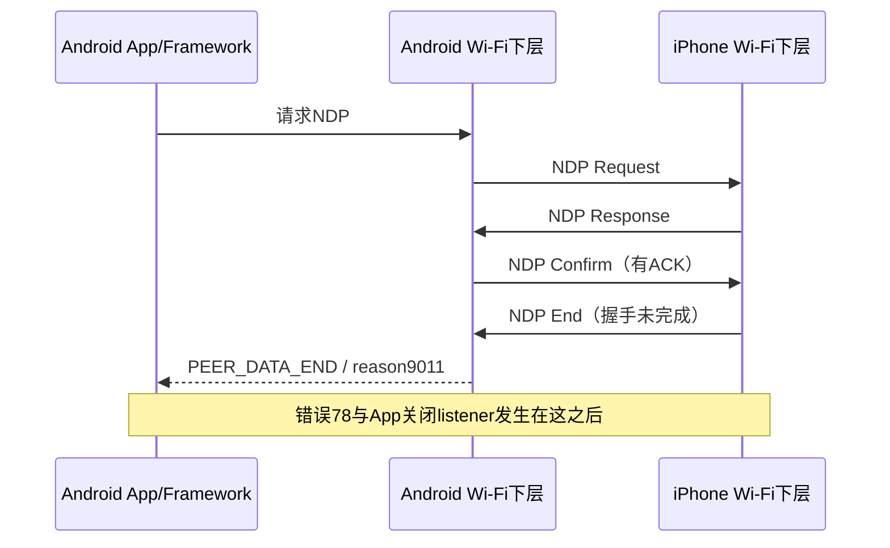

# SmartConnect 重连失败：NDP End 来源与固件日志字典核对

2026-11-25，承接[双端设备页面复测](SmartConnect-nan-reconnect-validation-2026-11-25.md)。本轮只操作已有配对设备页面，不扫码，不删除系统配对，不改固件或产品代码。

## 能确认的原因与尚未确认的部分

**失败的直接原因是：Android 已发出 NDP Confirm，但在握手完成前收到了对端 iPhone 的 NDP End；Android 随后上报 PEER_DATA_END。不是本应用通过 host-end 命令提前结束了这条 NDP。**

这是已定位到的协议/下层失败路径，不等于已经确认 iOS 固件代码有缺陷。iPhone 为什么发 End、Android Confirm 是否触发了对端安全/调度拒绝，现有证据没有给出完整内部原因。不能将“谁发 End”直接等同于“谁的软件有 bug”，也不能把此前所有 INSTALL_RX_FAIL 都认定为同一个根因。当前未修复，未把重试成功作为修复验收。

## 环境及证据完整性

- a0807d7 / TB323FU_PRC，Android17，驱动5.2.1.147N。
- dumpsys wifi 报告正在运行 `WLAN.GNG.2.0-01536-QCAGNGSWPL_V2_TO_SILICONZ-1.197458.2`；设备 amss20.bin SHA256为 `b6f89c304e8f01a276413bcc112807638f7d2340bb4c04b85b108799a3cbdae6`。这是高通调试固件，不是此前自行制作的185753实验补丁。
- iPhone12 / iPhone13,2，系统报告iOS27.2.1。SmartConnect使用此前8e92ce4的产品接入代码及独立主App测试签名。
- 同时采集Android Framework、内核/驱动、cnss_diag固件日志、iOS系统wifip2pd/kernel日志及Ubuntu空口。既有后台cnss_diag保持运行，没有停止用户原诊断服务。
- 单段Android内核日志观察到34次SUCCESS和2次PEER_DATA_END，包括后台和人工触发；不是严格独立同条件试验，不将其当作故障概率。后续连续成功不否定已经保留的失败。

## 先校正时钟，排除倒置的因果关系

不能直接按两端墙上时间排序。同一条BLE错误报文可一一匹配：

| wsPort / cmd / errorCode | Android发送 | iOS接收 |
| --- | --- | --- |
| 50838 / 2 / 78 | 18:10:22.576 | 18:10:21.807692 |
| 50840 / 2 / 78 | 18:10:45.879 | 18:10:45.146441 |

接收日志的墙上时间约早0.7～0.8秒，不代表消息倒流。按真实消息收发关系，Android先NDP失败，再发BLE错误78，iOS随后关闭WSS和Native listener。此前调查中提出“iOS收到78后提前关闭造成NDP失败”的假设已被排除。

Android常量78是 `GATT_ERROR_WIFI_CONNECT_TIMEOUT`。R4ConnectivityManager.handleWsFailure将NAN失败经现有Wi-Fi失败路径转换为该码；iOS的ServiceManager.OnDiscoveryMsg收到cmd2，关闭匹配端口的正在连接WSS，WebsocketBase.closeWithLock再调用nan.Close。这个路径属于失败后的回收及错误文案，不是本轮第一个NDP失败的起点。

## 18:36失败：系统及驱动同时确认握手中止

Android本机时间：

| 时间 | 事件 |
| --- | --- |
| 18:36:10.919 | Framework接受网络请求，已有系统配对验证已经成功 |
| 18:36:10.920 | initiateDataPathSetupLocal，transactionId1188 |
| 18:36:11.223 | 固件日志NAN_TX NDP_REQ |
| 18:36:11.285 | NAN_RX NDP_RSP |
| 18:36:11.357 | NAN_TX NDP_CONFIRM，tx_status0 |
| 18:36:11.492 | NAN_RX NDP_END |
| 18:36:11.494 | NDP_CONFIRM status:PEER_DATA_END |
| 18:36:11.502 | 驱动WMI_NDP_CONFIRM_EVENTID，rsp_code1，reason_code9011 |
| 18:36:11.501～11.509 | Framework onDataPathConfirm accept=false/reason2，随后回收网络 |
| 18:36:11.520以后 | App收到onUnavailable、关闭发现/会话 |

在这个NDP失败之前，没有Framework endDataPathLocal、App关闭会话或网络请求释放作为起点。驱动先收固件WMI失败通知，Framework及App才清理。不同日志输出线程的几毫秒交错不能当作因果倒置。

iOS本机时间18:36:10.388收到NDP Request，配对状态authenticated，选择datapathTransientKey，返回accepted；10.516收到Confirm/status continued；10.664上报early termination，未进入datapath established。本机app的Publish随后才停止。iOS daemon的“User Requested”和kernel的“Peer Initiated”是不同层的事件标签，单凭它们不能判定App调用了终止接口。

以下iOS日志在成功轮次也出现，已排除为独立根因证据：`Failed to decode key data of length 24576`、`handleDataPathConfirmRecvd ... Initiating peer ... not found`。也没有把日志级别ERROR本身当作连接失败证明。

## 19:08再次失败：固件实际走OTA接收End路径

等待复现时自动监测内核结果，一出现失败立即保存cnss_diag轮转文件。该轮Android本机时间：

- 19:08:37.796：NDP_REQ TX。
- 19:08:37.854/.859：NDP_RSP RX（收到重复Response）。
- 19:08:37.927：NDP_CONFIRM TX。
- 19:08:38.057：NDP_END RX。
- 19:08:38.058：PEER_DATA_END，没有NDP_INSTALL RX成功记录。

匹配字典重解释后的固件关键事件如下。时间差只在同一个固件日志时间域内计算，不与手机墙上时间直接相减：

| 相对Request ACK | 消息/函数 | 可以恢复的参数 |
| --- | --- | --- |
| 0 | wlan_nan20_sm_recvd_ack | oui_subtype5，sent_flag1 |
| 约132ms | wlan_nan20_sm_recvd_ack | oui_subtype7，sent_flag1，即Confirm对应ACK |
| 约262ms | **nan20_sm_data_end_received_ota** | **data_end_in_progress0，state4** |
| 约286ms | wlan_nan20_delete_sm_session | mode2，ndp_id1 |
| 约311ms | wlan_nan20_ndp_end_req_from_host_hdlr | vdev_id3，ndp_disable1，此时已经在做失败后的清理 |

关键定位点是高通日志字典指向的 `wlan_nan20_sm.c:3988 / nan20_sm_data_end_received_ota()`。`data_end_in_progress=0`及后续才发生的host-end路径，支持本轮由收到对端End触发，而非本机App/Framework先发结束命令。

## 高通日志解码字典确实不匹配

设备仅替换了amss20.bin，`/vendor/firmware_mnt/image/peach/Data20.msc`仍是旧字典。此次没有修改它，仅导出并与高通197458.2包内字典比较：

| 项目 | 设备现有字典 | 197458.2包内字典 |
| --- | --- | --- |
| 字节数 | 2024278 | 2024168 |
| VERSION | 268928976 | 268928976 |
| 可读消息数 | 19613 | 19612 |
| SHA256 | 1742dbe53887a239bb08d1a9824be1514a334ceebc29ab1e702eb8ec613e6e26 | fa711c932deb35bf9e1178e94db0d6a3565c557c42311cb169950cb197b18e45 |

共同消息ID中7450项格式/参数说明不同，首处变化ID17108。同VERSION不代表字典兼容。例：旧字典将29802解成“No FA found. Can't build NDC”，新字典同ID实际是“Slot %d selected as NDC slot”；前者不能拿来指认调度失败。

已有文件是按旧字典解过的**文本**，不是完整原始DIAG包。分析程序先按旧格式定位消息ID，再按相同ID的新格式解释能保留的参数；旧格式未输出的参数标为`arg unavailable`，没有补零或猜测。上表关键ID29616的两个参数仍可恢复；其它字段不可恢复不参与结论。此方法不能替代匹配字典下的原始DIAG解码，也没有把所有恢复内容当作完整源码跟踪。

固件内部打印时间与host线程落盘时间存在偏移/缓冲，不能把文本前缀host时间或固件tick未经校准就与内核墙上时间混排。这里同时使用NMI/NDI、dialog/ndp ID、动作顺序及内核事件关联，固件内部只计算同时间域的相对间隔。

## 空口与本机证据位置

Ubuntu按用户要求保存在 `/home/mxj/NAN/2026-11-25/`。失败轮次为 `smartconnect-root-failure-ch149-190650.pcap`，SHA256 `f2dd81119b4e1db996a0809590b987f08deb21c59e51649349c27e16bbef9560`。Mac归档在 `/Users/mxj/workspace/nan-capture-analysis/2026-11-25/smartconnect-root/`。

149信道包包含目标受保护Action帧及重传。由于没有NMTK，未解密NDP属性；没有把仅靠长度猜测的478/272字节Action帧当作已解码的某种NDP消息，也未从加密包臆测End属性的具体reason字段。收到NDP End的类型判定来自固件接收函数、驱动消息与Framework通知。

Mac还保留失败即时快照 `failure-snapshot/wlan_logs/`、`fw-after-failure.txt`、两份Data20字典及部分参数恢复结果 `confirmed-firmware-events.txt`。这些可能包含设备日志中的敏感字段或厂商资料，不上传本GitHub仓库。本文只列必要状态、函数和指纹。

## 剩余定位边界及没有执行的动作

尚缺：iPhone为何在Confirm后终止的内部原因，或能验证Confirm/End安全属性的解密报文。现有iOS内核/daemon事件未提供可靠的底层拒绝原因；仅凭“Peer Initiated”标签、MIC推测或End来源都不能继续定责。9011是Android报告“对端结束”的结果，不是解密后的对端NDP reason。

没有修改Wi-Fi HAL、固件、系统配对、Framework或SmartConnect产品逻辑；没有将延迟/自动重试当作根因修复。后续需要匹配版本的原始固件诊断或iOS侧更深的NDP失败原因，重点对照Confirm处理到Security Install之前的分支。本轮已经将调查从alias/App选择问题缩小到具体NDP握手阶段，但不能声称内部代码根因已完全查明。

收尾核实：Ubuntu已恢复managed，wlp3s0连接lenovo-internet，有默认路由，访问清华镜像HTTPS返回HTTP/2 200。恢复时第一次因接口尚不可用失败，第二次自行重试成功，未要求用户sudo。iPhone12已实测上滑无密码解锁，结束后SpringBoard锁屏0→1；Android恢复shell UID、临时日志级别清除，保留原cnss_diag服务，只停止本轮采集。
